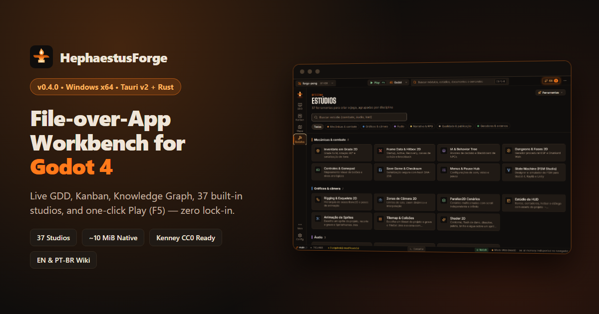

<p align="center">
  
</p>

<h1 align="center">HephaestusForge — Official Website, Wiki & Releases</h1>

<p align="center">
  <strong>File-over-App desktop workbench for indie game development with Godot 4.</strong><br/>
  Live GDD • Kanban • Knowledge Graph • 37 Built-in Studios • One-Click Play (F5)
</p>

<p align="center">
  <a href="https://hephaestusforge.vercel.app/"><strong>Official Website & Wiki (EN)</strong></a> •
  <a href="https://hephaestusforge.vercel.app/pt/"><strong>Site & Wiki (PT-BR)</strong></a> •
  <a href="https://github.com/Mateus-Mota/HephaestusForge-Site/releases/latest"><strong>Download Latest (Windows x64)</strong></a> •
  <a href="https://github.com/Mateus-Mota/HephaestusForge-Site/issues/new/choose"><strong>Report a Bug / Suggest a Feature</strong></a>
</p>

---

## About This Repository

This repository hosts:
- The official bilingual website and public Wiki (**English** & **Português BR**) built with **Astro 5 + Starlight**, deployed at [hephaestusforge.vercel.app](https://hephaestusforge.vercel.app/).
- Official public **Windows x64 installers** (`.exe` NSIS & `.msi`) with SHA-256 checksums under [GitHub Releases](https://github.com/Mateus-Mota/HephaestusForge-Site/releases).
- Public **Bug Reports & Feature Requests** via [GitHub Issues](https://github.com/Mateus-Mota/HephaestusForge-Site/issues).

> **Note:** The desktop application itself (built with Tauri v2 + Rust) is closed-source, while all project files it creates follow the **100% File-over-App** principle (`.md`, `.json`, `.tres`, `.tscn`, `.gd`, `.gdshader`, `.wav`) with zero lock-in.

---

## Downloads (`v0.4.0` — Windows 10/11 x64)

- **Quick download (NSIS `.exe`):** [hephaestusforge.vercel.app/download](https://hephaestusforge.vercel.app/download)
- **All installers & SHA-256 checksums:** [Downloads page](https://hephaestusforge.vercel.app/downloads/) | [GitHub Releases](https://github.com/Mateus-Mota/HephaestusForge-Site/releases/tag/v0.4.0)

---

## Contributing to the Wiki

Spotted a typo, broken link, or want to improve a guide in English or Portuguese? Pull Requests to `src/content/docs/` are welcome!

```bash
npm install
npm run dev      # Local preview at http://localhost:4321
npm run build    # Static build + Pagefind search index
```
